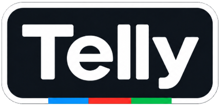
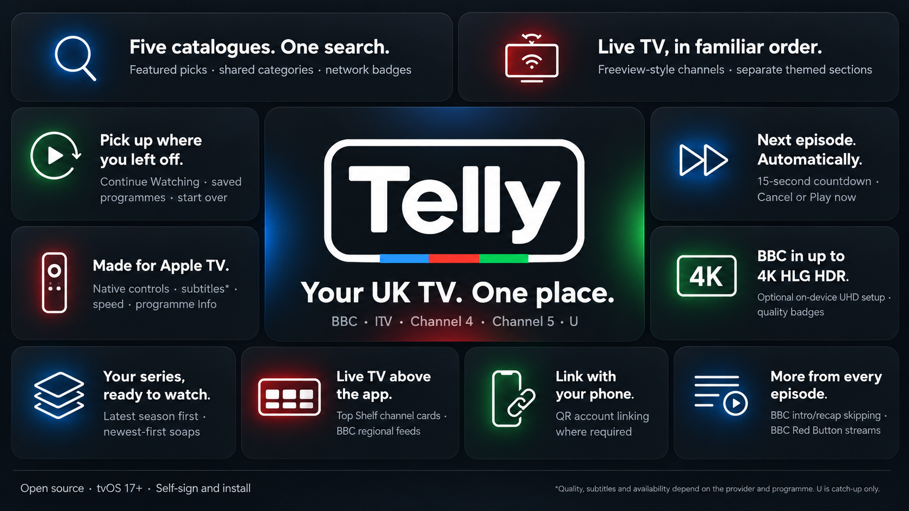

# Telly

**BBC, ITV, Channel 4, Channel 5 and U all in one app for Apple TV.**

Telly is an independent, open-source **tvOS 17+** app for discovering and watching UK television. Similar to Freeview, you can browse shared categories, search across five catalogues, watch live channels and continue a series without switching apps.

**Public preview: 0.8.1, build 40.** Download the [source ZIP](https://github.com/usefulappmaker/Telly-public/releases/download/v0.8.1/Telly-0.8.1-public-source.zip) or [prebuilt unsigned IPA](https://github.com/usefulappmaker/Telly-public/releases/download/v0.8.1/Telly-0.8.1-public-unsigned.ipa) from [GitHub Releases](https://github.com/usefulappmaker/Telly-public/releases/tag/v0.8.1). Both require your own Apple signing and provisioning. There is no App Store or TestFlight release.

[Install with Xcode](INSTALL.md) · [Sign the unsigned IPA](INSTALL-IPA.md) · [Feature and quality notes](docs/FEATURES.md) · [Release notes](CHANGELOG.md)

## Five networks, one library

- **Featured:** highlights from the BBC, ITV, Channel 4, Channel 5 and U.
- **Browse together:** shared categories across providers. Films, Comedy, Drama, Entertainment and more live in one place.
- **Search:** programme title and synopsis search across the catalogues, using the Apple TV keyboard and supported iPhone keyboard/dictation.
- **Saved programmes:** bookmark a show across any supported network and open its available episodes later.
- **Continue Watching:** locally saved progress, resume/start-over actions, and the next available episode after completion.
- **Episode navigation:** programme pages open on the latest available numbered season/year. Soaps use newest-first browsing. Other series retain forward episode order.
- **Automatic next episode:** at the actual end of an episode, a 15-second countdown offers **Cancel** and **Play now**. Autoplay uses the next known available episode in chronological order and stops when no successor is known.

BBC and ITV standard network category/View all pages offer **Date | A-Z**, with a remembered shared choice. Mixed-network category pages have no sort control. Channel 4, Channel 5, U and the 4K UHD category use alphabetical ordering without a toggle. Date uses genuine known broadcast/release metadata, with undated titles alphabetically last; BBC also requests recent-first listing pages. Metadata dates are cached when opening programmes. Availability-window, artwork-update and cache-refresh timestamps are not used as broadcast dates.

## Live television

- BBC, ITV, Channel 4 and Channel 5 streams share a **Freeview-style ordering**: BBC One, BBC Two, ITV1, Channel 4, Channel 5, then the other supported channels.
- Separate **ITV themed** and **Channel 5 themed** offer FAST channels (e.g. The Chase). The current metadata snapshot contains 65 live channel listings; availability and themed-channel names can change.
- **Network filters** and current-programme artwork where supplied.
- **Top Shelf:** place Telly in the Apple TV home screen's top row for direct-launch channel cards, using matching ordered sections and Channel 5 support. Top Shelf uses native text section titles.
- **BBC regions:** choose among 16 BBC One regions and three BBC Two feeds. Top Shelf starts the selected region; its schedule artwork follows the default feed.
- **BBC Red Button streams:** Red Button and event-dependent Red Button UHD streams, with Cancel/Back and an error that preserves the current stream when an additional feed is unavailable.

## Native playback

- Apple's AVPlayer/AVKit controls, programme Info, artwork, synopsis, date, runtime and guidance where supplied.
- On-demand playback-speed choices from 0.5× to 2×; live streams retain normal speed.
- Native subtitles on compatible feeds, including BBC live subtitles. Availability differs by provider, programme and stream.
- BBC intro/recap skipping when timings match the playing version.
- Received-picture quality badges: **4K, FHD, HD or SD** (where available).
- Iconic vintage BBC blue/red/green colour scheme. Programme-page and Continue Watching preparation pulse the header logo; playback loading uses matching bars. Reduce Motion is respected.

## Networks and quality

| Provider | Catalogue/catch-up | Live | Current quality position |
|---|---|---|---|
| BBC | Yes | Yes | HD; compatible catch-up and event streams can reach 4K HLG HDR with optional UHD setup and suitable hardware/content. |
| ITV | Yes | Standard and themed channels | FHD confirmed on physical Apple TV; the supplied stream and programme still determine quality. |
| Channel 4 | Yes | Yes | Catch-up requests HD-capable FairPlay streams where available; resolution varies by programme. Live quality remains provider-dependent. |
| Channel 5 | Yes | Standard and themed channels | FHD confirmed for supported streams. Some programmes remain SD. |
| U | Yes | N/A | FHD catch-up confirmed on  Apple TV. |

These are observed capabilities, not a guarantee for every programme. Regional restrictions, provider accounts, rights windows, subscription restrictions and service availability still apply.

## Accounts and data

ITV live playback, Channel 5 and U can request account linking through an on-screen QR/code flow; you may wish to use a dummy account for registration. Complete sign-in on the provider's website with your own account.

Account sessions and optional UHD identity are kept in device Keychain storage. Bookmarks, watch progress and catalogue caches stay locally. There is no cross-device history sync (yet). Telly contacts broadcaster services and artwork hosts; this is not an offline catalogue.

Ordinary supported playback runs on Apple TV without a separate computer/server after installation. Optional **Settings → Enable BBC UHD** runs its TwinVine configuration setup on Apple TV; it is not needed for ordinary HD playback. A Mac/Xcode or compatible signing setup is still needed to install the app.

## Build and install

Open **Telly.xcodeproj**, choose your own signing team for **Telly** and **TellyTopShelf**, and set **TELLY_APP_BUNDLE_IDENTIFIER** to a unique identifier. The public default is `com.example.Telly`; no developer team is selected. Pair your Apple TV with Xcode, select the Telly scheme and run. See [INSTALL.md](INSTALL.md) for details.

For the prebuilt **Telly-0.8.1-public-unsigned.ipa**, sign both the app and embedded Top Shelf extension using your own tvOS provisioning before installation. See [INSTALL-IPA.md](INSTALL-IPA.md). Do not try to install an unsigned IPA directly.

## Development and attribution

[Build/test instructions](DEVELOPMENT.md) · [Validation scope](VALIDATION.md) · [Release boundary](PUBLIC-RELEASE.md) · [Report a problem](.github/ISSUE_TEMPLATE/bug_report.md)

Telly derives from [Beeb-public](https://github.com/usefulappmaker/Beeb-public). It is licensed under **[GPL-3.0-or-later](LICENSE.txt)**. BBC discovery adapts get_iplayer, and optional UHD setup follows TwinVine's iP service. See [NOTICE.md](NOTICE.md).

Telly is unofficial and is not produced, sponsored or endorsed by the BBC, ITV, Channel 4, Channel 5 or UKTV. Their names, logos, programme images and video belong to their respective owners. No broadcaster app binaries, personal account sessions, developer signing material or media decryption keys are included.
